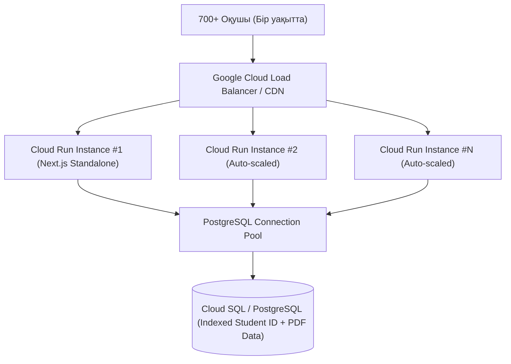

# Жүйелік Архитектура, High-Concurrency (700+ Users) және Google Cloud Run Деплойы

## 1. Технологиялық Стек

* **Фреймворк:** `Next.js 15+` (App Router, TypeScript, Node.js `standalone` серверлік жинағы)
* **Дерекқор (Database):** `PostgreSQL 16` (`pg` Connection Pool + Prisma ORM)
* **Стильдеу:** `Tailwind CSS` + `Lucide Icons`
* **Архив және PDF өңдеу:** `JSZip` (ZIP архивтерді серверде жедел ашу және ID бойынша сәйкестендіру)
* **Email қызметі:** `Nodemailer` (SMTP / Gmail App Password / Resend / SendGrid қолдауымен)
* **Контейнеризация және Cloud:** `Docker` (Multi-stage build) + `docker-compose.yml` + **Google Cloud Run**

---

## 2. Бір уақытта 700+ оқушы кіргенде жүйе құламауы (High-Concurrency Design)

Олимпиада нәтижесі шыққан сәтте (18 желтоқсан және 15 қаңтар) 700 немесе одан көп оқушы мен ата-ана сайтқа бір мезетте кіреді. Жүйе мінсіз жұмыс істеуі үшін мына архитектуралық шешімдер қолданылады:



1. **Күйсіз (Stateless) Контейнерлер және PDF Сақтау:**
   * Google Cloud Run контейнерлерді жүктемеге қарай автоматты түрде көбейтіп-азайтады (ephemeral disk). Егер PDF файлдар жай папкада сақталса, контейнер қайта қосылғанда өшіп қалады.
   * **Шешім:** Әр оқушының PDF табелі (`~50–150 KB`) тікелей PostgreSQL дерекқорының арнайы `ResultPdf` кестесінде (`BYTEA` бинарлы дерек ретінде) сақталады. 700–1000 оқушының барлық PDF файлы бар болғаны `50–100 MB` орын алады.
   * Оқушы тек мета-деректерді сұрағанда (`GET /api/results/201001`), бинарлы PDF оқылмайды (жеңіл JSON қайтады). Ал PDF-тің өзін ашқанда (`GET /api/results/201001/pdf`), индекс бойынша тікелей ағынмен (stream) беріледі.
2. **HTTP Кэштеу (`Cache-Control`):**
   * `/api/results/[studentId]/pdf` маршрутына `Cache-Control: public, max-age=3600, s-maxage=86400` тақырыбы қойылады. Оқушы парақты қайта жаңартса да, сервер мен базаға қайта-қайта салмақ түспейді.
3. **B-Tree Бірегей Индекстері:**
   * `students.student_code` (`201001`) өрісінде `UNIQUE INDEX` болады. Базадан 6-таңбалы код бойынша іздеу уақыты — $O(\log N)$, яғни `< 1 \text{ мс}$.
4. **Атомарлы ID Генерациялау (Race Condition алдын алу):**
   * Тіркелу кезінде `branch_code` пен `grade` жұбына арналған реттік нөмір PostgreSQL транзакциясы (`INSERT ... ON CONFLICT DO UPDATE` атомарлы counter кестесі) арқылы беріледі. Екі оқушы бір миллисекундта тіркелсе де, біріне `202001`, екіншісіне `202002` беріледі.

---

## 3. Дерекқор Схемасы (PostgreSQL)

### 1. `branches` (Филиалдар)
* `id`: `SERIAL PRIMARY KEY`
* `code`: `INT UNIQUE NOT NULL` (мысалы: `1` = Lumina, `2` = Durlești)
* `name_ro`: `VARCHAR(120)`
* `name_ru`: `VARCHAR(120)`
* `name_en`: `VARCHAR(120)`
* `address`: `TEXT`
* `is_active`: `BOOLEAN DEFAULT true`

### 2. `id_counters` (Атомарлы реттік нөмір есептегіші)
* `branch_code`: `INT NOT NULL`
* `grade`: `INT NOT NULL`
* `last_seq`: `INT NOT NULL DEFAULT 0`
* `PRIMARY KEY (branch_code, grade)`

### 3. `students` (Тіркелген оқушылар)
* `id`: `UUID PRIMARY KEY`
* `student_code`: `VARCHAR(6) UNIQUE NOT NULL` (мысалы: `201001`)
* `first_name`: `VARCHAR(100) NOT NULL`
* `last_name`: `VARCHAR(100) NOT NULL`
* `grade`: `INT NOT NULL` (`2`..`8`)
* `school`: `VARCHAR(200) NOT NULL`
* `teacher_name`: `VARCHAR(150) NOT NULL`
* `exam_language`: `VARCHAR(5) NOT NULL` (`RO`, `RU`, `EN`)
* `branch_id`: `INT REFERENCES branches(id)`
* `email`: `VARCHAR(150) NOT NULL`
* `phone`: `VARCHAR(50) NOT NULL`
* `email_sent`: `BOOLEAN DEFAULT false`
* `has_result_pdf`: `BOOLEAN DEFAULT false`
* `created_at`: `TIMESTAMPTZ DEFAULT now()`

### 4. `student_results` (PDF Табельдер)
* `student_code`: `VARCHAR(6) PRIMARY KEY REFERENCES students(student_code) ON DELETE CASCADE`
* `file_name`: `VARCHAR(120) NOT NULL`
* `pdf_data`: `BYTEA NOT NULL`
* `file_size`: `INT NOT NULL`
* `uploaded_at`: `TIMESTAMPTZ DEFAULT now()`

---

## 4. Google Cloud Run Баптаулары (Ұсынылатын конфигурация)

Деплой кезінде 700 оқушыны еш кідіріссіз қабылдау үшін Cloud Run командасы:

```bash
gcloud run deploy luminamath \
  --source . \
  --region europe-central2 \
  --allow-unauthenticated \
  --memory 1Gi \
  --cpu 2 \
  --concurrency 80 \
  --min-instances 1 \
  --max-instances 15
```

* `--concurrency 80` және `--max-instances 15`: бір мезетте $80 \times 15 = 1200$ параллель сұранысты өңдей алады.
* `--min-instances 1`: емтихан және нәтиже шығатын күндері Cold Start болмауы үшін 1 контейнер үнемі ояу тұрады.

---

## 5. `luminamath.md` Доменін Тіркеу және Қосу

1. **Домен мәртебесі:** Веб-іздеу нәтижесі бойынша `luminamath.md` доменінде қазір белсенді сайт жоқ. Оны Молдованың ұлттық тіркеушісі [nic.md](https://www.nic.md) арқылы тіркеп алуға болады.
2. **Cloud Run-ға байланыстыру:**
   * Google Cloud Console $\rightarrow$ Cloud Run $\rightarrow$ **Manage Custom Domains** $\rightarrow$ `luminamath.md` қосу.
   * `nic.md` DNS панеліне Google берген `A`, `AAAA` және `CNAME` (`www`) жазбаларын енгізу (Google SSL сертификатын автоматты түрде тегін шығарады).
